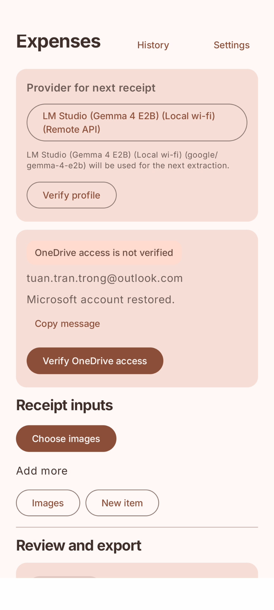
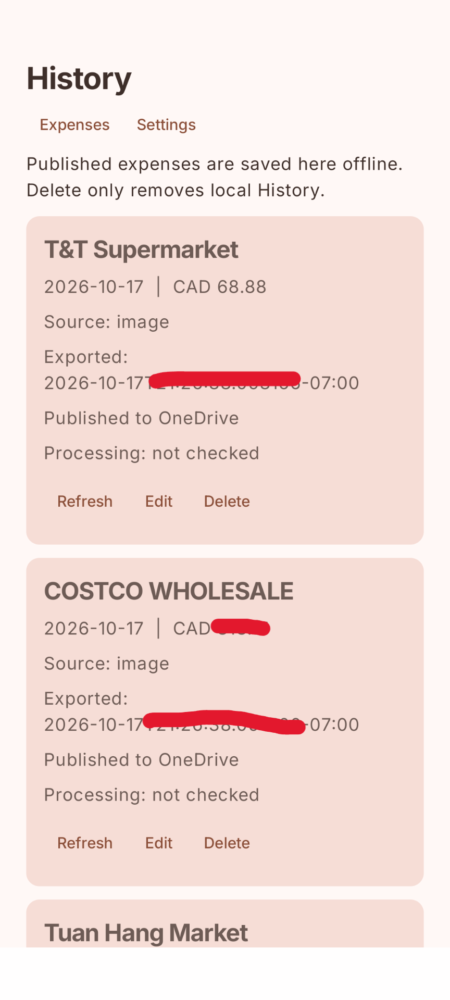
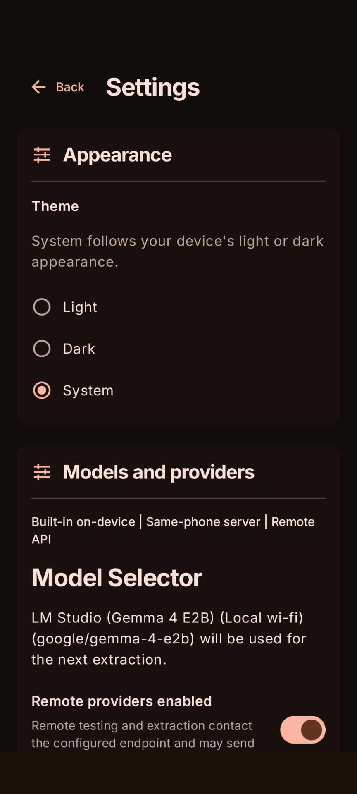
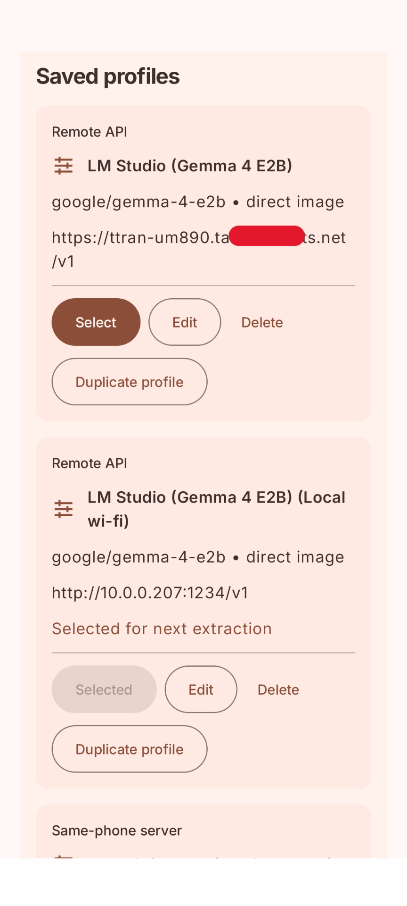
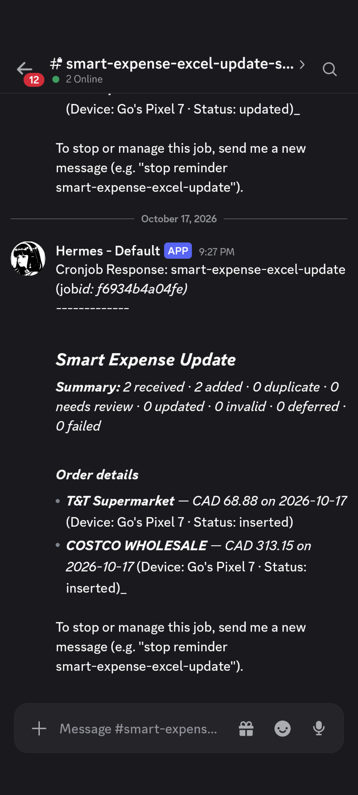

<p align="center">
  
</p>

<h1 align="center">Smart Expense Tracking</h1>

<p align="center">
  <strong>From receipt to spreadsheet, with you in control.</strong><br>
  Review receipt photos and typed expenses on Android, export through OneDrive,<br>
  and keep your Excel budget up to date with private Discord updates.
</p>

<p align="center">
  <a href="#prerequisites"></a>
  <a href="#tech-stack"></a>
  <a href="#setup-and-run"></a>
  <a href="#implementation-status"></a>
</p>

<p align="center">
  <a href="#personal-workflow">Workflow</a> &middot;
  <a href="#features">Features &amp; screenshots</a> &middot;
  <a href="#tech-stack">Tech stack</a> &middot;
  <a href="#setup-and-run">Getting started</a> &middot;
  <a href="#verify">Verification</a>
</p>

## Tech stack

<p align="center">
  <a href="https://developer.android.com/studio"></a>
  <a href="https://kotlinlang.org/"></a>
  <a href="https://gradle.org/"></a>
  <a href="https://learn.microsoft.com/powershell/"></a>
</p>

<p align="center">
  
  
  
  
  
  
</p>

**Android:** Kotlin, Jetpack Compose / Material 3, Room, MSAL, and LiteRT-LM or a selected OpenAI-compatible provider. **Windows:** Hermes schedules deterministic PowerShell jobs that update desktop Excel through COM and report outcomes to Discord.

> **Android review → OneDrive handoff → Windows Excel update → Discord result**

Skill icons by [Skill Icons](https://skillicons.dev); custom badges by [Shields.io](https://shields.io).

## Why this exists

Canada's open-banking policy is formally called the **Consumer-Driven Banking Regulations**. It is still being implemented: the Government of Canada pre-published the proposed Regulations for consultation in June 2026, ahead of their staged coming-into-force after final publication. See the Department of Finance Canada's [official update on the proposed Consumer-Driven Banking Regulations](https://www.canada.ca/en/department-finance/news/2026/06/government-pre-publishes-regulations-to-prevent-fraud-and-facilitate-the-next-phase-of-consumer-driven-banking.html).

Until secure, standardized bank-data sharing is broadly available, automatic expense-tracking apps cannot work consistently across Canadian financial institutions. I currently manage monthly spending in an Excel workbook, but entering transactions manually is tedious. This project automates that personal process while keeping ongoing costs minimal.

## Personal workflow

1. Choose receipt images or add typed expenses with **No receipt image**. Prepare and inspect up to 20 inputs in one mixed batch.
2. Choose **Extract all**, or **Extract** on a no-image card, to request review from the selected LLM provider. Use **Retry extraction** to reprocess one item.
3. Review each group's results, then export individually or choose **Export All** to confirm every remaining transaction and publish one JSON list. All remaining items must be ready and valid. Images use paired Version 2 JPEG/JSON; typed expenses use manual Version 3 JSON with notes and no image.
4. Successful exports move to persistent **History**. Refresh processing status, edit eligible pending/done expenses, and explicitly **Re-export** a correction. Delete/Undo removes only local History. Compatible Windows consumer capability is required for re-export; JSON publication and Excel application appear separately.
5. A five-minute cron job on a mini PC reads the synchronized handoff, updates the correct monthly sheet in the Excel workbook, and posts reportable results to a private Discord channel.

## Features

### 1. Capture and review on Android

- Select multiple images, inspect their exact processed previews with zoom controls, remove/Undo, and add more before **Extract all**.
- Mix images with no-image expenses described in any field, including Merchant or Notes alone. The LLM interprets expressions such as `15+50`, dates such as `Oct 7 2026`, and currency names; original drafts stay visible beside normalized results and suggestions for confirmation.
- A dedicated no-image prompt accepts natural expense narratives and returns the shared receipt format, ready for future voice-transcribed text.
- Image/OCR/typed prompts receive today's device-local reference date to interpret unclear dates for review; missing dates still require correction.
- No-image cards show **Extract / Retry extraction** and **Confirm and export**; confirmation requires a current valid review and ready OneDrive access.
- Collapse input groups and retry one failed input while retaining the other results and stable export identities.
- Review each distinct transaction separately, correct fields when needed, and export low-confidence receipts as `confirmed` or corrected receipts as `manual`.
- Keep receipt work on Main, with provider, OneDrive, image-preprocessing, and device-name settings in Settings.
- Choose **Light**, **Dark**, or **System** in **Settings → Appearance → Theme**. Your choice is saved and applies across Expenses, History, and Settings, with Android 12+ dynamic colors.

<p align="center">
  
  
</p>

<p align="center"><em>Expenses: prepare and review inputs. History: revisit published expenses and corrections.</em></p>

### 2. Extract with a provider you control

- Use Built-in on-device LiteRT-LM, explicitly select a Same-phone server, or opt in to a saved Remote API provider.
- Use **Copy message** or long-press diagnostics to copy errors; the companion offers **Copy** for its saved and active endpoint URLs.
- Manage multiple provider profiles securely and import or export their configuration without credentials.
- Duplicate a saved profile with its own credential copy, or use **Load models** in the editor to search an OpenAI-compatible provider's model IDs. Manual entry remains available; save and provider selection are explicit.
- Enable **Show Tailscale control on Main** per remote profile for on-demand connect/disconnect requests. Install and sign in to Tailscale first; save the Tailscale Serve URL `https://<MINI_PC_NAME>.<TAILNET_NAME>.ts.net/v1` without `:1234`, with LM Studio **Allow local network access** enabled. Main shows live VPN detection and checks `GET /models` while foregrounded, with up to 30 seconds of connect retries. VPN detection cannot identify Tailscale; models reachability does not verify inference. See [the reusable checker inputs](docs/6.tailscale-integration-goal.md#reusable-models-endpoint-check).

<p align="center">
  
  
</p>

<p align="center"><em>Choose your appearance and manage saved inference providers.</em></p>

### 3. Hand off the receipt through OneDrive

- Connect a personal Microsoft account and publish a normalized receipt JPEG before its versioned JSON handoff, with retry support.
- Preserve image-first Version 2 handoffs; explicit typed Version 3 handoffs omit images and keep Excel column H empty. The compatible Windows processor must be deployed before publishing typed records.
- **Export All** publishes one ordered JSON array after every required image upload. Deploy the compatible Windows processor before using combined lists; retries preserve the original export membership.
- Windows accepts CAD only; other currencies are quarantined for review without conversion. Notes remain in archived JSON.
- New objects include `itemType: pending`; done corrections use `processed` in immutable, revision-checked operations that update the existing Excel entry. Deploy the [compatible consumer](docs/12.correction-protocol.md) before enabling re-export.

### 4. Update Excel and notify privately

- An agent harness such as Hermes Agent or OpenCode manages the five-minute cron schedule and the private Discord communication on the mini PC.
- Its deterministic script-only job processes synchronized OneDrive handoffs and updates the Excel workbook through desktop Excel.
- Empty runs stay quiet; inserts, corrections, duplicates, and review/error outcomes are delivered to the configured private Discord channel. Successful corrections include the updated expense details.
- Hermes archives applied corrections in `receipt_jsons_done`, routes conflicts/invalid files to review/error, and keeps deferred operations queued. Unchanged deferred handoffs notify once; retries continue quietly until the reason or outcome changes.

<p align="center">
  
</p>

<p align="center"><em>A private Discord summary reports the Excel processing outcome.</em></p>

## Prerequisites

- Android Studio with Android SDK Platform 35 and Build Tools installed.
- JDK 17 or the JDK bundled with Android Studio.
- A connected Android device or emulator (Android 9 / API 28 or newer) to run the app.

## Setup and run

1. Clone the repository and open it in Android Studio, or use the Gradle wrapper from the repository root.
2. Set `sdk.dir` in `local.properties` to your Android SDK location if Android Studio has not created it.
3. Build and install the debug app:

   ```powershell
   .\gradlew.bat :android-app:assembleDebug
   .\gradlew.bat :android-app:installDebug
   ```

4. In the app, open Settings to configure an optional remote provider or connect and verify OneDrive before exporting receipts.
5. Enable Debug output in Settings to inspect the raw extraction response and each generated handoff JSON on Main.

After code changes, run the app from Android Studio or repeat `:android-app:installDebug`; opening an emulator alone keeps its previously installed app.

<details>
<summary><strong>Building on another PC</strong></summary>

To build on another PC while keeping the existing Microsoft sign-in registration, copy the original `%USERPROFILE%\.android\debug.keystore` from the PC that built the registered APK to the same location on the new PC. This file is ignored by Git and must be transferred separately. If it is unavailable, register the new PC's debug certificate in Entra and update the MSAL redirect URI and manifest path as described below.

</details>

<details>
<summary><strong>On-device extraction and Same-phone AI Companion setup</strong></summary>

Local on-device extraction additionally requires `gemma-4-E2B-it.litertlm` in the app's private models directory. The Android LiteRT-LM device path is still being validated; remote providers are optional and require explicit opt-in.

For **Same-phone server**, install the supported **Same-phone AI Companion** (Android API 31+), a modified fork of [`techjarves/mobile-server`](https://github.com/techjarves/mobile-server) based on upstream commit `a0ca94a9f79f1e5dbea0cb315f565f5512cae6b7`. Provision/import a compatible vision model, load it, and explicitly Start. In expense Settings, add a profile, choose **Same-phone server**, match the companion's endpoint (default `http://127.0.0.1:8080/v1`) and optional key, enter or load the model ID, save, select, and verify before extraction. Remote opt-in is independent. To remove a client key, choose **Clear key** and Save; align or clear keys in both apps. Stop/restart the companion and explicitly Retry after unconfirmed cleanup; use **Recover credentials** for pending secure cleanup. See [client verification](docs/10b.mobile-server-expense-app-verification.md) and [companion setup](docs/10a.mobile-server-companion-verification.md).

The companion's HTTP chat requires the expense app's request-preparation extension. Generic OpenAI chat apps need explicit support for that contract; successful model discovery or built-in companion chat does not establish external chat compatibility. Verification failures show the request stage, HTTP status and safe error code for troubleshooting. Prompt-only verification accepts a complete JSON code block; invalid-output errors distinguish empty, malformed and unexpected JSON after a successful HTTP response.

</details>

## Microsoft Graph OneDrive authentication

OneDrive export uses MSAL with a Microsoft Entra ID **public-client** registration for a personal Microsoft account. To create a registration for your own build:

<details>
<summary><strong>Microsoft account registration and OneDrive configuration</strong></summary>

1. In the [Microsoft Entra admin center](https://entra.microsoft.com/), open **App registrations** > **New registration**, select **Personal Microsoft accounts**, and copy the resulting **Application (client) ID**.
2. Open the registration's **Authentication** page. Under **Add a platform**, choose **Android** and enter this app's package name: `com.hugo.smartexpense.app`. Generate the signature hash from the keystore used to sign the APK, enter it, and copy the portal-generated `msauth://...` redirect URI. Enable **Allow public client flows** under **Advanced settings**.
3. Under **API permissions**, add Microsoft Graph **delegated** permission `Files.ReadWrite`. Do not add application permissions or create a client secret: an Android app is a public client and the user grants access to their own OneDrive.
4. Replace `client_id` and `redirect_uri` in `android-app/src/main/res/raw/auth_config_single_account.json`. Update the `BrowserTabActivity` intent-filter path in `android-app/src/main/AndroidManifest.xml` to the same URL-decoded signature hash (not the URL-encoded JSON value). Keep the existing `PersonalMicrosoftAccount` authority and `SINGLE` account mode.
5. Create the target OneDrive folders before connecting: `Documents/2_Others/Expenses_finance/logs` and `Documents/2_Others/Expenses_finance/receipt_images`. In the app, use **Connect** and then **Verify OneDrive access**.

The debug build validates that its signing certificate matches both configured redirect values. A new PC's generated debug key has a different certificate, so copying the original debug keystore preserves the existing registration. If the original key is unavailable, register the new key's hash in Entra, then update the MSAL JSON redirect and manifest path together. Release builds require a redirect registered for the release-signing certificate. See Microsoft's [Android redirect URI setup](https://learn.microsoft.com/en-us/entra/identity-platform/how-to-add-redirect-uri), [MSAL Android configuration](https://learn.microsoft.com/en-us/entra/msal/android/configure-your-app), and [Microsoft Graph permissions reference](https://learn.microsoft.com/en-us/graph/permissions-reference#files-permissions).

</details>

## Verify

Run the JVM tests and assemble the Android app:

```powershell
.\gradlew.bat test :android-app:assembleDebug
```

The repository also includes contract fixtures and PowerShell checks in `fixtures/` and `scripts/`.

Batch Settings default to one item at a time and 3.5 seconds between remote request starts, with a maximum of three concurrent items. On-device inference stays serial. Measure your model/server before increasing concurrency.

## Implementation status

The core receipt-to-Excel workflow is implemented and verified on Pixel 7. Built-in LiteRT-LM receipt extraction and additional same-phone runtime checks remain open. See [current status](docs/current%20status.md) for the full record.

<details>
<summary><strong>Completed milestones and remaining validation</strong></summary>

Plan 12 (History, date context, and expense corrections) and its correction-notification detail fix are ✅ Done and verified on Pixel 7, confirmed by Hugo on 2026-10-17. See [verification](docs/12.export-history-verification.md#pixel-7-verification-confirmation).

Multiple-image and no-image support, including free-text entry, Export All, and item-level extraction/export actions, is ✅ Done and verified on Pixel 7, confirmed by Hugo on 2026-10-08.

The Android receipt workflow, provider profile management, OneDrive authentication, image-first paired export, and provider configuration transfer are implemented and have unit-test coverage. Physical-device validation has confirmed the main workflow, remote LM Studio extraction, profile transfer, and OneDrive export. The Windows PowerShell/Excel COM processor is implemented and verified against disposable copies of the real workbook. Its five-minute Hermes no-agent job is active, uses the repository PowerShell entry point through a thin external wrapper, and delivers reportable outcomes to Discord.

Phase 1 integration work remains in progress. The main open item is validating on-device LiteRT-LM receipt extraction. Run the Windows checks with `pwsh -NoLogo -NoProfile -NonInteractive -File scripts/test-handoff-contract.ps1` and `pwsh -NoLogo -NoProfile -NonInteractive -File scripts/test-hermes-excel-update.ps1`; the latter copies the real workbook to a disposable temp tree and never writes the source. See [the current status](docs/current%20status.md), [the implementation plan](docs/PLAN.md), and [the requirements](docs/requirements.md) for details.

Same-phone client and companion software are implemented. Plans 10a/10b Verify, receipt-photo extraction and typed-expense extraction are ✅ Done on Pixel 7, confirmed by Hugo on 2026-10-12. Offline use, cancellation/retry, performance and background checks remain unconfirmed; see the [companion evidence](docs/10a.mobile-server-companion-verification.md#phone-verification-confirmation) and [expense-app evidence](docs/10b.mobile-server-expense-app-verification.md#phone-verification-confirmation).

</details>
