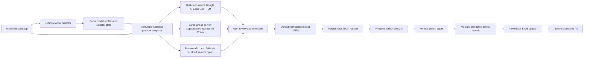

# Smart Expense Tracking Implementation Plan

Last updated: 2026-10-25

✅ Done (2026-10-25): [Plan 12 I12-9](12.export-history-date-context-and-json-edit-plan.md#i12-9--add-tappable-history-receipt-thumbnails) implements tappable History receipt thumbnails and the shared zoomable viewer, local-first loading, verified on-demand OneDrive recovery, private bounded caching and Room v6 drive binding. Shared/Android unit tests, debug build, instrumentation compilation and focused History emulator checks pass against `REQ-UI-016`/`AC-068`. Pixel 7 History thumbnails and image viewing are ✅ Done, confirmed by Hugo on 2026-10-25; live OneDrive recovery verification remains Pending. See [Gap 19](gap-closing-plan-details.md#gap-19-history-receipt-thumbnails) and [verification](12.export-history-verification.md#history-receipt-thumbnails-and-viewer-i12-9).

✅ Done (2026-10-17): [Gap 18](gap-closing-plan-details.md#gap-18-correction-archival-and-quiet-deferred-retries) adds terminal correction archival, ledger-based acknowledgement recovery, archive-aware Android retries and persistent quiet deferred retries for correction/original handoffs. Unit/wrapper/disposable Excel regressions, targeted Android tests and debug assembly pass; see [verification](12.export-history-verification.md#correction-archival-and-quiet-deferred-retries).

✅ Done (2026-10-17): Hugo confirmed physical-device verification of Plan 12 and its correction-notification expense-details fix on Pixel 7. See [device confirmation](12.export-history-verification.md#pixel-7-verification-confirmation). Individual scenario/provider details were not recorded.

✅ Done (2026-10-16): [Plan 12 I12-7](12.export-history-date-context-and-json-edit-plan.md#i12-7--include-expense-details-in-correction-notifications) supplies corrected expense details to successful update notifications. Actual consumer-to-renderer regressions, 55 correction assertions, 30 disposable Excel COM assertions, 17 wrapper tests, installed renderer verification and debug assembly pass; see [evidence](12.export-history-verification.md#correction-notification-expense-details-follow-up).

✅ Done (2026-10-16): [Iteration 12 software and automated verification](12.export-history-verification.md) adds Room v5 History, device-local extraction date context, explicit immutable corrections, and revision-aware existing-entry Excel updates with journals/acknowledgements. Shared/Android unit tests, debug build, focused emulator tests, disposable Excel canaries and installed-wrapper parity pass. Physical-device verification of Plan 12 and the I12-7 notification fix is ✅ Done on Pixel 7, confirmed by Hugo on 2026-10-17; detailed scenario/provider evidence is recorded separately in the verification record.

✅ Done (2026-10-12): Hugo confirmed **Verify, receipt-photo extraction and typed-expense extraction worked on Pixel 7** for plans [10a](10a.mobile-server-companion-plan.md) and [10b](10b.mobile-server-expense-app-integration-plan.md). This supersedes earlier blanket phone-verification/paired-photo Pending statements. Offline use, cancellation/retry/native drain, accuracy/latency/memory and background acceptance remain unconfirmed; see both verification records.

## Stack Direction

Android app:

- Kotlin
- Jetpack Compose
- Android Photo Picker and CameraX
- Room for model-profile metadata, selector state, and local export history
- Three provider categories behind one extraction interface: Built-in on-device Google AI Edge/LiteRT-LM (default/fallback), Same-phone server (optional supported companion fork), and Remote API (optional with explicit remote opt-in)
- Saved OpenAI-compatible profiles for Same-phone server and Remote API; protocol does not determine inference location
- Settings screen with persistent multi-profile management and a Model Selector
- Single-activity Compose navigation with a focused Main receipt workflow and separate Settings destination

Windows automation:

- Hermes agent as scheduler/orchestrator
- Deterministic PowerShell action running in Hermes script-only/no-agent mode
- Desktop Excel COM for native workbook updates
- Atomic local state under `%LOCALAPPDATA%`, plus workbook-level duplicate checks
- Five-minute polling with quiet empty runs and concise Discord delivery for reportable outcomes

Data exchange:

- Image-backed expenses: one normalized receipt JPEG plus Version 2 JSON per confirmed transaction
- Typed expenses: explicit no-image manual Version 3 JSON, preserving notes
- Export All: one ordered JSON array of existing image/typed objects, image-first publication, immutable Room export membership, and Windows replay-safe expansion into per-expense processing
- No-image extraction uses a dedicated natural-language prompt with the shared normalized receipt output, supporting future voice-transcribed text
- Versioned schema
- Microsoft Graph upload to OneDrive as the queue/sync transport
- Image-first publication for Version 2; temporary/final JSON commit for both versions

Excel integration:

- Target workbook: `D:\Users\tuant\OneDrive\Documents\2_Others\Expenses_finance\Canada plan.xlsx` (tests copy it before any write)
- Target sheet name: monthly `YYYY-MM`
- Fill the first safe row from 12-100 where columns F and G are both empty; do not insert or reorder rows.
- Map amount to F, normalized merchant plus `MMM dd` date to G, and a relative image hyperlink to H for Version 2; clear H for typed Version 3.
- Preserve E, O, formulas, formatting, and unrelated workbook content.
- Copy the latest earlier monthly sheet when needed, clear only F:H rows 12-100, and extend `Food Expense Summary` using its existing 89-row monthly detail pattern.
- Skip exact date/amount/normalized-merchant duplicates and quarantine same-date/same-amount merchant conflicts.
- Accept CAD only; quarantine other currencies without conversion.

## Architecture

✅ Done (2026-10-12): Companion terminal cleanup now dispatches outside native callbacks and retains admission through cleanup, including cancellation before native start. Expense verification failures show safe request-stage/HTTP/code diagnostics; **81 shared/244 Android unit tests** and the expense debug build/test compilation pass. See [the Pixel 7 investigation and companion checks](10a.mobile-server-companion-verification.md#callback-cleanup-and-verification-diagnostics-revision). Resolution of the reported Pixel 7 Verify failure and native/paired/physical acceptance remain Pending.

Same-phone server implementation details: [companion plan](10a.mobile-server-companion-plan.md) and [expense-app integration plan](10b.mobile-server-expense-app-integration-plan.md), under [the integration goal](10.mobile-server-integration-goal.md). Companion and expense-app software are implemented. Expense verification passes 79 shared/244 Android unit tests, APK build/test compilation and 40 full emulator tests; GPT 6 Astra review/fixes/re-review are complete. See [client evidence](10b.mobile-server-expense-app-verification.md). [The exact GPU test](10a.mobile-server-companion-verification.md) remains blocked by the AVD's missing OpenCL; native-drain proof, paired native extraction and physical validation remain pending.

## Phases

### Phase 0: Requirements and Feasibility

Status: ✅ Done

Deliverables:

- Requirements draft
- Feasibility summary
- Open decisions list
- Initial implementation plan

### Phase 1: Integration Spikes

Status: In Progress

Planning artifact:

- `docs/1.integration-plan.md`

Goals:

- Evaluate and spike optional OpenAI-compatible API extraction behind the same structured extraction contract first.
- Define the Settings Model Selector contract for Built-in on-device, Same-phone server, and Remote API providers.
- Verify the Google AI Edge API or LiteRT-LM Android extraction path after the API-provider path is proven. Parser/validation spike is implemented; Android device/model execution is pending.
- Prototype receipt extraction, including whether OCR/preprocessing is required.
- ✅ Done: Implement and unit-test paired Microsoft Graph upload from Android: receipt JPEG first, then the final JSON handoff. Physical-device verification remains.
- ✅ Done: Make Android debug signing use the stable host debug keystore and fail debug builds when the APK certificate does not match the configured MSAL JSON and manifest redirects.
- Implement and verify the Hermes/PowerShell contract in `docs/3.excel-update-hermes-goal.md`.
- Verify next-empty-row mapping, monthly-sheet creation, and summary integration against a disposable copy of the real workbook.
- Verify state-based idempotency, exact duplicate skipping, and similar-record quarantine against the monthly sheet.

### Phase 2: Android MVP

✅ Done (2026-10-17): Added persistent Light/Dark/System selection under **Settings → Appearance → Theme**, with System default/fallback and immediate shared-theme/system-bar updates (`REQ-UI-015`, `AC-066`). Seven new regressions cover persistence, system resolution, accessible callbacks, draft/content retention and Android 9/15 bars. All 308 Android unit tests pass; 94 shared tests remain passing/up to date. Debug assembly and device-test compilation pass. See [Gap 17](gap-closing-plan-details.md#gap-17-app-theme-preference); physical-device appearance verification remains pending.

Export All and dedicated narrative prompt revision: ✅ Done on 2026-10-07. All remaining inputs must be ready; one ordered mixed JSON array uses image-first publication, Room v4 immutable membership and restart-safe reconciliation. Windows list expansion preserves existing per-expense processing. Unit/emulator/copy-workbook checks and debug build pass; see [the batch plan verification record](9.multiple-and-no-image-support-plan.md). Voice capture and production rollout remain future work.

Status: In Progress

Goals:

- Mixed image/typed batch implementation and verification: see [the batch support plan](9.multiple-and-no-image-support-plan.md). Stage private processed images, persist Room metadata, use stable item/transaction revisions, grouped review, explicit Extract all, and shared provider budgets. Initial limit is 20 inputs, Built-in on-device concurrency one, Remote API concurrency one to three with 3.5-second default spacing. Planned Same-phone server concurrency is one with a 180-second extraction deadline; remote start spacing applies only to Remote API. Keep keys outside batch state. Hardware benchmark and processor deployment evidence are tracked separately.
- ✅ Done (2026-10-10): Aligned requirements using Option B's three provider categories (`REQ-M-001..035`, `REQ-A-023..024`, `REQ-UI-002/009..010`, `NFR-001..003A`, `AC-008/012/019/024/031/034/041/052..060`). Same-phone selection is independent of remote opt-in; Built-in on-device remains default/fallback. Companion implementation and device validation remain Pending under [the integration goal](10.mobile-server-integration-goal.md).
- ✅ Done (2026-10-11): Expense-app same-phone profiles, literal-loopback configurable endpoint, optional secure keys/journal recovery, Prompt-only JSON, Room/transfer v3, discovery/verification, immutable category-aware scheduling and acknowledged cancellation are implemented and client-tested. Existing Remote API and handoff contracts remain covered. Full `AC-057..060` acceptance remains open for native/paired/physical checks recorded in 10b; available client software verification is complete.
- ✅ Done (2026-10-08): No-image cards expose **Extract / Retry extraction** for just that item and visible **Confirm and export**, disabled until current valid results and OneDrive readiness. Shared scheduling/provider snapshots, draft preservation, edit confirmation, busy guards and immutable exports remain in force (`REQ-A-030`, `AC-051`). All 60 shared/217 Android unit tests and debug assembly pass; see the batch plan for emulator verification. Physical-device validation remains pending.
- ✅ Done: Free-text no-image revision implemented and automatically verified on 2026-10-06. Every source field is an optional hint; Merchant or Notes alone can describe the full expense. Combined-draft eligibility excludes blank/default-only CAD input. Text-only LLM extraction uses evidence from every field, arithmetic/natural-language dates/currency, and visible merchant typo suggestions; original strings/notes remain separate. Unresolved facts and invalid structured/manual results block export. All 59 shared tests, 188 Android unit tests, 27 emulator UI tests, and debug assembly pass against `REQ-A-022`, `REQ-A-025`, `AC-043`, `AC-047`. Live provider interpretation and physical-device checks remain pending; see the batch plan verification record.

- Capture/import receipt image.
- ✅ Done: Prevent Main/Settings controls from overlapping Android system UI with shared safe drawing inset handling. All 121 Android unit tests pass (including four inset layout regressions), device UI tests compile, and debug assembly succeeds on 2026-10-01. Physical-device validation: ✅ Done, confirmed by Hugo on 2026-10-01 (`REQ-UI-012`, `AC-037`).
- ✅ Done: Add Main's selected-image Retry extraction using the retained processed image and current effective provider. All 117 Android unit tests pass, Compose tests compile, and the debug APK assembles on 2026-10-01. Hugo confirmed physical-device validation on Pixel 7 on 2026-10-01; see `docs/7.retry-extraction-plan.md`.
- ✅ Done: Provide a default-enabled option that reduces selected images larger than 200 KB to strictly below 200 KB before extraction.
- ✅ Done: Add a selected-image review thumbnail that opens the complete post-preprocessing image used for extraction, as detailed in `docs/5.image-review-plan.md`. Hugo verified the feature on a physical Pixel 7 on 2026-09-21.
- ✅ Done: Added pinch-to-zoom, bounded pan, and accessible Zoom in/Zoom out controls to the selected-image viewer under `REQ-UI-008` and `AC-033`, following `docs/5.image-review-plan.md`. Automated verification passed, and Hugo verified zoom and text legibility on a Pixel 7 on 2026-09-22.
- ✅ Done: Separate Main receipt operations from Settings configuration while preserving receipt state across navigation; add compact provider verification, contextual OneDrive readiness, and local Gemma model-file readiness checks.
- ✅ Done: Verify the separated Main and Settings experience on a physical Pixel 7.
- Extract receipt fields with the selected provider, defaulting to on-device extraction.
- ✅ Done: In both direct-image and OCR-text prompts, treat matching itemized and finalized receipts as one transaction and extract the finalized amount including tax and tip without summing receipt totals.
- ✅ Done: Represent distinct transactions from one image as separate `receipts` elements, review and export each independently, and include a detected or manually configured device name in each JSON.
- ✅ Done: Validate strict remote extraction request JSON and the nested receipts schema, reject trailing-comma regressions, and retry `invalid_json` JSON-schema extraction once without `response_format`; provide a default-off Settings Debug control for raw extraction responses and per-receipt generated handoff JSON.
- ✅ Done: Configure, test, save, select, edit, and delete persistent OpenAI-compatible provider profiles through Settings, with secure per-profile credentials and local fallback.
- ✅ Done: Export all saved remote-provider metadata and selector state to a versioned JSON document, and preview/import validated profile files atomically without exporting credentials or changing the current selection.
- ✅ Done: Implement profile-gated on-demand Tailscale requests near the Main provider selector, with a Settings-only per-profile flag, Room v1-to-v2 migration/schema, provider-configuration v2/v1 import compatibility, cancellable reachability retries, and separate request/VPN/models endpoint status. The 2026-09-30 extension adds foreground VPN observation and periodic GET models checks, with a reusable checker accepting custom URL/key/path/timeouts. Shared tests, all 113 Android unit tests, Compose test compilation, and debug assembly pass. See `docs/6.tailscale-integration-goal.md`. Physical-device validation: ✅ Done on Pixel 7, confirmed by Hugo on 2026-09-30.
- Review and correct extracted data.
- ✅ Done: Export unchanged, user-confirmed low-confidence receipts with `confirmed` status and user-edited receipts with `manual` status.
- ✅ Done: After the receipt image succeeds, publish the final Version 2 JSON handoff using Microsoft Graph.
- ✅ Done: Upload a normalized receipt JPEG below 200 KB first and include its deterministic OneDrive-relative path in the Version 2 JSON.
- ✅ Done: Preserve one stable expense ID, export timestamp, image path, and JSON name across retries.
- ✅ Done: Resolve or create the `receipt_images/YYYY-MM` hierarchy idempotently before image upload.
- ✅ Done: Track export status locally with a Room-backed record and actionable retry state.

Testing:

- ✅ Done: Verified the live VPN/models status extension with all 113 Android unit tests, shared tests, ten affected Compose tests on the Pixel 8a API 35 emulator, and debug APK assembly on 2026-09-30 (`REQ-M-027..028`, `REQ-UI-009..010`, `AC-034..035`).
- Unit tests for extraction response parsing.
- ✅ Done: Unit tests for the multiple-receipt prompt contract in both direct-image and OCR-text modes.
- ✅ Done: Unit tests parse complete image and OCR request JSON and verify the receipt schema, provider errors, Debug persistence, and independent export previews.
- Unit tests for provider/model selection rules.
- ✅ Done: Unit tests for provider-configuration JSON round trips, invalid input, credential exclusion, conflict copying, selector preservation, ViewModel confirmation, and atomic Room persistence.
- Unit tests for OpenAI-compatible request construction, credential redaction, and error mapping.
- Unit tests for handoff schema generation.
- ✅ Done: Unit tests for receipt-image normalization, paired path generation, upload ordering, and idempotent retry.
- ✅ Done: Unit and Compose UI tests for processed-image state, preview replacement/clearing, thumbnail activation, and full-image dismissal; Compose tests compile, and Hugo confirmed device behavior on a Pixel 7 on 2026-09-21.
- ✅ Done: Unit tests for zoom/pan limits and reset; Compose UI tests for zoom controls and dismissal compile, the debug APK assembles, and Hugo verified gesture/legibility behavior on a Pixel 7 on 2026-09-22.
- Unit tests for validation rules.
- UI tests for review/edit flow where practical.
- UI tests for Model Selector behavior where practical.

### Phase 3: Windows Agent MVP

Status: ✅ Done (production job active after Hugo's separate live-activation approval)

Goals:

- ✅ Done: Implement the deterministic PowerShell processor and install its thin Hermes script wrapper.
- ✅ Done: Validate final Version 2 JSON files, filename correlation, paired local receipt images, accepted extraction status, and CAD currency.
- ✅ Done: De-duplicate by atomic local expense-id state and conservative workbook matching.
- ✅ Done: Skip exact date/amount/normalized-merchant duplicates and quarantine same-date/same-amount merchant conflicts.
- ✅ Done: Fill the first safe F/G row from 12-100 in the `YYYY-MM` worksheet, with the amount in F, merchant/date in G, and relative image hyperlink in H.
- ✅ Done: Create a missing monthly sheet by copying the latest earlier month and extend `Food Expense Summary` only when its known structure validates.
- ✅ Done: Preserve valid handoffs when Excel is locked, read-only, full, or structurally unexpected.
- ✅ Done: Archive successful and exact-duplicate files; quarantine ambiguous and invalid files with actionable reasons.
- ✅ Done: Activate job `f6934b4a04fe` after Hugo's separate approval. It runs every five minutes in script-only/no-agent mode, delivers to Discord channel `1549288366992793652`, and is pinned to `gpt-5.6-luna` with high reasoning.

Testing:

- ✅ Done: Unit tests for Version 2 validation, path safety, mapping, row selection, duplicate classification, state atomicity, routing, and Hermes output.
- ✅ Done: Copied-workbook Excel COM tests for insertion, hyperlink behavior, native-content preservation, missing-month creation, and summary extension.
- ✅ Done: Recovery seams for state/archive failures and idempotent reruns; lock/read-only/full handling is covered by deterministic code paths and capacity assertions.
- ✅ Done: The disposable-path Hermes canary completed successfully and Discord message `1549441490327965807` was read back from the configured channel. The production override was removed afterward; following Hugo's separate approval, the production job is active.

### Phase 4: Optional External Receipt Photo Link

Status: Pending

Goals:

- Keep using Amazon Photos as the phone backup location.
- Add receiptPhotoLink to the handoff schema only when a stable Amazon Photos link is available.
- Include the link in Excel only when present.
- Keep this optional full-resolution external link separate from the required normalized OneDrive receipt JPEG.

Testing:

- Unit tests for optional-link handling.
- Integration test that missing links do not block expense processing.

## Design Principles

- Prefer stable documented APIs over UI automation.
- Keep the handoff file small, structured, and versioned.
- Treat OneDrive as eventually consistent.
- Make every processing step idempotent.
- Require human review before export in the MVP.
- Keep cloud AI disabled by default, and require explicit user opt-in before sending receipt data to a remote model provider.
- Keep Built-in on-device, Same-phone server, and Remote API extraction behind one provider abstraction and one normalized output contract. Same-phone selection is explicit and independent of remote opt-in; only Remote API may transmit inference data outside the phone.
- Upload only the normalized sub-200-KB receipt JPEG required by the expense workflow; Amazon Photos may remain the independent full-resolution backup.

## Definition of Done

A planned task is done only when:

- implementation is complete
- unit tests cover the behavior
- behavior is checked against `docs/requirements.md`
- relevant docs/status files are updated
- the task status is marked ✅ Done
